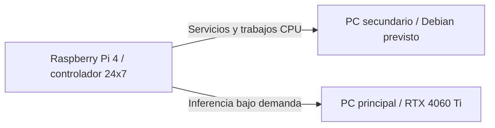

# Pi Agents — Raspberry Pi AI Orchestration Server

La **Raspberry Pi 4 de 4 GB** arranca desde SSD con **Raspberry Pi OS Lite 64-bit (Debian 13 Trixie)**. El chat principal confirmó el reinicio tras actualizar y el acceso SSH con clave ED25519. El siguiente hito es comprobar la estabilidad del SSD durante uso prolongado. [Dosier maestro del homelab](docs/dosier-maestro.md).

**English overview.** Pi Agents is a headless Raspberry Pi controller for a planned three-node AI homelab. The OS migration and SSH key access are verified. Distributed job execution is planned.

## Estado del controlador · 10 de noviembre de 2026

| Componente | Observación comunicada |
|---|---|
| Sistema | Raspberry Pi 4, 4 GB, ARM64. Kernel observado `6.18.50+rpt-rpi-v8` |
| Almacenamiento | Kingston SV300S37A120G de unos 120 GB. Raíz EXT4 en `/dev/sda2`, con unos 101 GB libres. `/dev/sda1` montada en `/boot/firmware` |
| Enlace USB | USB 2.0 a 480 Mb/s con controlador UAS. Se mantiene provisionalmente por errores de E/S anteriores en USB 3.0 |
| Administración | Hostname `pi-agents`, usuario `afvv2602`, Wi-Fi principal por `wlan0`. Acceso SSH por clave ED25519. Windows preparado para SSH Agent y el alias `pi-agents` |
| Salud tras actualizar | Reinicio correcto, reloj sincronizado por NTP en `Europe/Madrid` y `vcgencmd get_throttled` con resultado `0x0` |
| Registros del arranque observado | Sin errores de E/S ni de EXT4 en las líneas filtradas. Avisos no críticos de MMC, audio, Bluetooth y Wi-Fi |

La estabilidad prolongada del SSD y la causa de los fallos en USB 3.0 siguen abiertas. En la instalación nueva están **pendientes de verificar** Tailscale, Docker Engine y Docker Compose, FastAPI, SQLite como persistencia de la aplicación, el scheduler/orquestador propio y el registro y la coordinación de nodos. [Seguimiento del SSD](docs/05-resolucion-problemas.md) · [Fases y criterios de aceptación](docs/00-roadmap.md).

## Acceso desde Windows

Con el alias local y la clave configurados para `afvv2602`, el comando de PowerShell es `ssh pi-agents`. La guía incluye la configuración de OpenSSH, la carga de la clave ED25519 en SSH Agent y la comprobación de la identidad del host después de una reinstalación. [Red local y SSH](docs/02-red-y-ssh.md).

## Arquitectura prevista

El proyecto prevé un orquestador propio en Python para agentes de IA e integración con Obsidian. Las futuras escrituras en el vault requerirán validación, revisión de cambios y una copia recuperable.

La Raspberry conservará el estado y los trabajos pendientes cuando un PC esté apagado. El secundario alojará servicios y almacenamiento. El principal aportará la GPU cuando esté disponible. El primer trabajo distribuido deberá quedar registrado con su resultado. [Diseño de arquitectura](docs/04-arquitectura.md).

## Guías y decisiones

- [Instalación de Raspberry Pi OS Lite y comprobaciones de arranque](docs/01-instalacion-raspberry-pi-os.md)
- [Operación diaria, actualizaciones y seguimiento de estabilidad](docs/06-operaciones.md)
- [Validación pendiente de Tailscale](docs/03-tailscale.md)
- [Decisión de migrar a Raspberry Pi OS Lite](docs/adr/0003-raspberry-pi-os-lite.md)
- [Política de seguridad y tratamiento de evidencias](SECURITY.md)

## Historial de DietPi

En la microSD se verificaron la administración local con `piadmin` y el acceso SSH por Tailscale desde Windows en la misma LAN. El 9 de noviembre se confirmó un arranque de DietPi desde SSD por USB 2.0. Las pruebas de la microSD no acreditan acceso por Tailscale en Raspberry Pi OS Lite. [Instalación histórica](docs/01-instalacion-dietpi.md) · [Historial de cambios](CHANGELOG.md).

## Licencia

El código y la documentación originales se distribuyen bajo la [licencia MIT](LICENSE). Los componentes de terceros conservan sus respectivas licencias.
