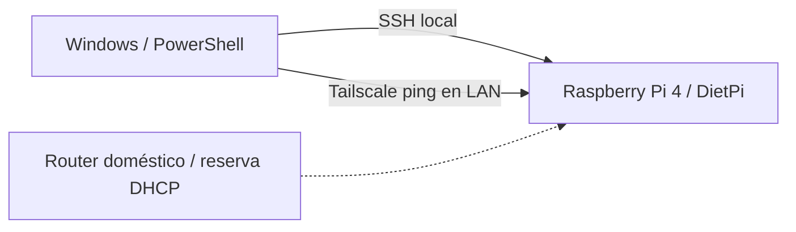
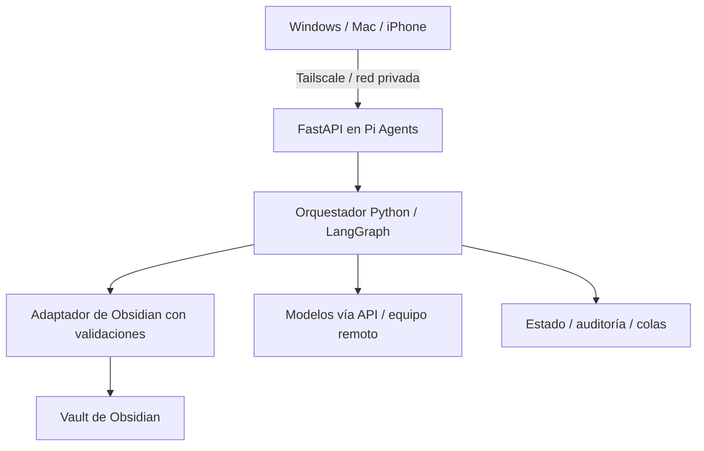

# Pi Agents — Raspberry Pi AI Orchestration Server

> **Estado:** infraestructura base operativa · acceso remoto Tailscale pendiente · agentes IA en diseño.\
> **Idioma:** documentación técnica en español.\
> **English overview:** Lightweight, secure, headless Raspberry Pi 4 platform intended to orchestrate Python-based AI agents, integrate with Obsidian and connect remote inference services. This repository documents both completed work and the implementation roadmap; unfinished components are explicitly marked as planned.

## ¿Qué es este proyecto?

**Pi Agents** es un proyecto *homelab* y de portfolio para convertir una **Raspberry Pi 4 (4 GB)** en un servidor Linux de bajo consumo, gestionado remotamente y preparado para coordinar servicios y agentes de IA.

La Raspberry actuará como **orquestador**, no como motor principal de inferencia: los modelos podrán ejecutarse en un equipo más potente (por ejemplo, un Mac mini) o consumirse mediante APIs externas. El primer caso de uso será automatizar de forma segura un vault de Obsidian (búsqueda de notas, creación de vocabulario, enlaces y validación de plantillas).

El repositorio está pensado como evidencia verificable de **administración Linux, redes, acceso seguro, automatización, infraestructura reproducible y arquitectura de servicios**, no como demostración de funcionalidades aún no implementadas.

## Estado real del proyecto

| Hito | Estado | Evidencia |
|---|---|---|
| DietPi en Raspberry Pi 4 | ✅ Completado | Arranque y acceso a terminal |
| Acceso SSH desde Windows | ✅ Completado | Sesión `piadmin` funcional |
| Hostname `pi-agents` | ✅ Completado | Salida de `hostname` |
| Zona horaria `Europe/Madrid` | ✅ Completado | Salida de `timedatectl status` |
| Reserva DHCP para Wi-Fi | ✅ Registrada | Entrada *Static Lease* habilitada en router |
| Usuario no-root con `sudo` | ✅ Completado | `sudo whoami` devuelve `root` |
| Alias de OpenSSH `pi-agents-local` | ✅ Completado | Acceso confirmado desde Windows |
| Autenticación SSH exclusivamente por clave | 🟡 Pendiente de verificar y endurecer | Comprobar autenticación forzada; deshabilitar contraseña solo después |
| Actualizaciones pendientes/estado APT | 🟡 Pendiente de comprobar | Verificar versiones y estado de paquetes |
| Comprobaciones previas a Tailscale | ✅ Parcialmente comprobadas | Captura del 2026-10-29: Debian 13.7, hora sincronizada, ~55 GB libres y `dpkg --audit` sin incidencias; nivel de actualizaciones aún pendiente |
| Tailscale y acceso desde otra red | 🟡 SSH por Tailscale comprobado en LAN | Login como `piadmin` con clave pública y sin contraseña de cuenta, sobre la IP Tailscale. Faltan prueba desde otra red y reconexión tras reinicio; ver [guía](docs/03-tailscale.md) |
| Docker, API y orquestador de agentes | ⏳ Pendiente | Ver [arquitectura](docs/04-arquitectura.md) |
| Integración de Obsidian | ⏳ Pendiente | Diseño; sin escrituras automáticas todavía |

**Convención:** ✅ confirmado en la instalación previa según el registro del proyecto · 🟡 requiere una comprobación adicional · ⏳ no implementado. Las pruebas recientes proceden de capturas aportadas por el usuario; Codex no ha ejecutado comandos en la Raspberry.

## Hardware y software

| Componente | Configuración observada |
|---|---|
| Equipo | Raspberry Pi 4 Model B, 4 GB RAM |
| Arquitectura | ARM64 / `aarch64` |
| Sistema operativo | DietPi v10.8.2, basado en Debian 13 (Trixie) |
| Almacenamiento | microSD ~64 GB; SSD USB de 111,8 GiB detectado como `/dev/sda`, partición NTFS `/dev/sda1` sin montar. Eventos de desconexión por aclarar; ver [INC-006](docs/05-resolucion-problemas.md) |
| Conectividad | Wi-Fi (`wlan0`), dirección por DHCP con reserva en router |
| Hostname | `pi-agents` |
| Administración | Windows + PowerShell + OpenSSH |
| Usuario administrativo | `piadmin` (sudo verificado) |

**Privacidad:** este repositorio **no publica** IP local exacta, MAC, claves SSH, credenciales del router, SSID, contraseñas, tokens ni información privada del vault. Usar marcadores como `<IP_LOCAL>` y `<TAILSCALE_IP>`.

## Arquitectura

### Actual — verificada



### Objetivo — aún no desplegado



Las rutas de datos, autenticación, permisos y persistencia se detallarán a medida que se implementen. Consulta [docs/04-arquitectura.md](docs/04-arquitectura.md).

## Estructura del repositorio

```text
pi-agents/
├── README.md
├── CHANGELOG.md
├── SECURITY.md
├── .gitignore
├── docs/
│   ├── 00-roadmap.md
│   ├── 01-instalacion-dietpi.md
│   ├── 02-red-y-ssh.md
│   ├── 03-tailscale.md
│   ├── 04-arquitectura.md
│   ├── 05-resolucion-problemas.md
│   ├── 06-operaciones.md
│   └── adr/
│       ├── 0001-elegir-dietpi.md
│       └── 0002-acceso-remoto-tailscale.md
└── scripts/
    └── conectar-pi-agents.bat
```

## Cómo reproducir la fase actual

1. Instalar DietPi ARM64 en una microSD para Raspberry Pi 4; completar el primer arranque.
2. Confirmar conectividad y hora de sistema.
3. Configurar hostname, zona horaria y usuario sin privilegios directos de root.
4. Crear una reserva DHCP en el router para la interfaz de red usada.
5. Configurar SSH desde Windows con un alias y, tras verificarlo, acceso por clave pública.

Procedimiento: [instalación de DietPi](docs/01-instalacion-dietpi.md) y [red/SSH](docs/02-red-y-ssh.md). No automatizar cambios de seguridad antes de completar sus pruebas.

## Próximo hito: acceso remoto seguro

Tailscale está instalado en la Raspberry y en Windows. Ambos dispositivos aparecen en la misma *tailnet* y SSH por clave funciona sobre la IP Tailscale estando en la LAN. El siguiente paso es repetir la prueba desde otra red (por ejemplo, un punto de acceso móvil) y comprobar reconexión tras reinicio, **sin abrir puertos del router**. Ver [guía y criterios de aceptación](docs/03-tailscale.md).

## Principios del proyecto

- **Seguridad primero:** privilegios mínimos, SSH con claves, sin credenciales en Git, autorizaciones explícitas para editar notas.
- **Automatización comprobable:** cada hito incluye comandos de verificación y fallos conocidos.
- **Evolución incremental:** Linux y conectividad → contenedores → API → orquestación → integraciones.
- **Documentación como código:** decisiones (ADR), *changelog*, guías y evidencias reproducibles.

## Documentación y referencias

- [Roadmap y criterios de aceptación](docs/00-roadmap.md)
- [Instalación y configuración inicial](docs/01-instalacion-dietpi.md)
- [Red local, DHCP y SSH](docs/02-red-y-ssh.md)
- [Tailscale (en pruebas)](docs/03-tailscale.md)
- [Diseño de arquitectura](docs/04-arquitectura.md)
- [Incidentes y soluciones](docs/05-resolucion-problemas.md)
- [Operaciones del servidor](docs/06-operaciones.md)
- [Política de seguridad](SECURITY.md)

**Fuentes oficiales:** [DietPi](https://dietpi.com/docs/) · [SSH en DietPi](https://dietpi.com/docs/software/ssh/) · [Tailscale en DietPi](https://dietpi.com/docs/software/vpn/) · [Instalación Linux de Tailscale](https://tailscale.com/docs/install/linux) · [MagicDNS](https://tailscale.com/docs/features/magicdns).

## Licencia

Código y documentación originales de este proyecto: MIT (ver `LICENSE`). Marcas, paquetes y herramientas de terceros mantienen sus respectivas licencias.
