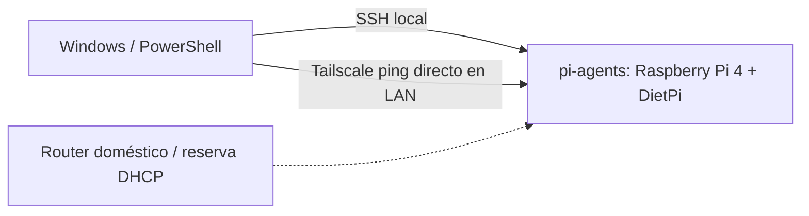
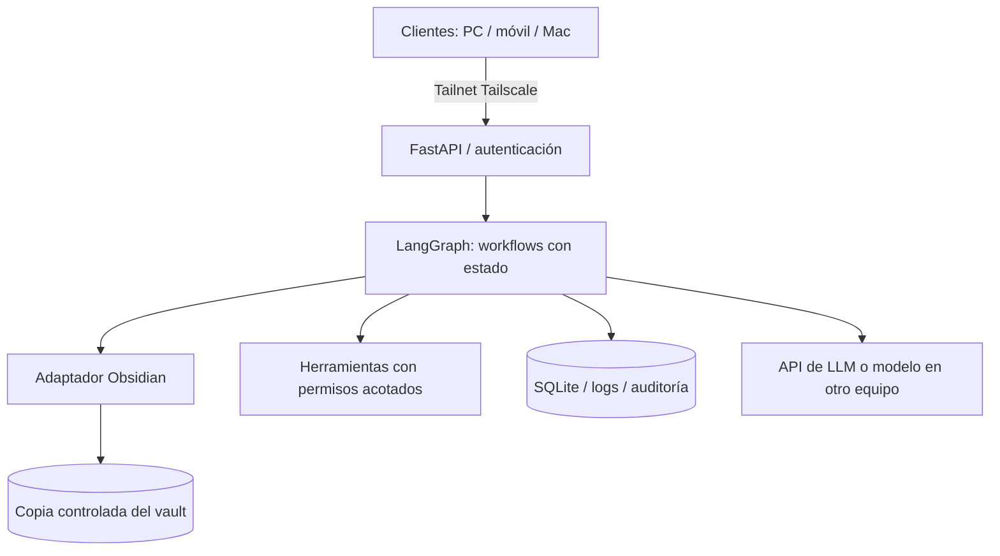

# 04 — Arquitectura y evolución

> Las cajas marcadas como **plan** aún no están implementadas. No deben mostrarse en portfolio como producción.

## Arquitectura actual (comprobada)



La infraestructura actual incluye Linux, red local, acceso SSH local, usuario administrador y ambos dispositivos unidos a Tailscale. `tailscale ping` ha respondido en ambos sentidos sobre una ruta directa en la LAN. SSH por Tailscale y acceso desde otra red siguen sin verificar.

## Arquitectura objetivo (diseño)



## Restricciones técnicas

- Raspberry Pi 4 de 4 GB: suficiente como orquestador ligero, pero no para inferencia local potente.
- Arquitectura ARM64: comprobar imágenes Docker multiplaforma y dependencias nativas.
- microSD: vigilar escritura, salud y backups; estudiar SSD antes de usar bases de datos intensivamente.
- Conectividad Wi-Fi: añadir reintentos, observabilidad y evitar suponer disponibilidad total.
- Vault Obsidian: iCloud no es un sistema de archivos Linux montado nativamente; habrá que usar un servicio puente en Mac u otra sincronización oficialmente soportada antes de permitir escrituras.

## Plan de contenedores (futuro)

```text
services/
  gateway-api/       # FastAPI
  orchestrator/      # LangGraph / workers
  obsidian-bridge/   # adaptación del vault
  scheduler/         # tareas programadas
infra/
  compose.yaml
```

No instalar todos los servicios de inicio: primero healthcheck, logs y autenticación; después persistencia y gestión de tareas.

## Caso de uso inicial: vocabulario de chino

1. El usuario envía una palabra (p. ej. 老师).
2. La API valida petición y la identidad.
3. Un workflow busca las notas de vocabulario y hanzi existentes.
4. Genera una propuesta siguiendo las plantillas configuradas.
5. Ejecuta validaciones de YAML, enlaces y nombres de archivo.
6. Aplica cambios en un entorno de prueba; ofrece diff y aprobación.
7. Escribe en el vault autorizado, registra ejecución y permite rollback.

**Principio de seguridad:** agentes proponen; validadores autorizan; escrituras destrutivas requieren aprobación.

## Alternativas estudiadas

- DietPi frente a Raspberry Pi OS Lite: menor peso y herramientas simplificadas.
- Docker Compose frente a K3s: preferir simplicidad en un solo nodo con 4 GB.
- Tailscale frente a port forwarding: preferir red privada sin exponer SSH.
- LLM remoto frente a LLM local: optimizar RAM, latencia y capacidad del modelo.

Ver decisiones en [`adr/`](adr/).
