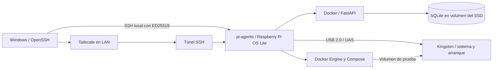
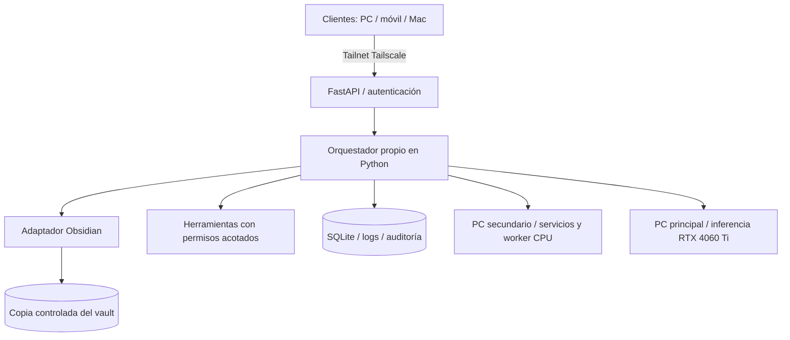

# 04 — Arquitectura y evolución

El estado del controlador procede del traspaso del 10 de noviembre de 2026. El segundo diagrama describe la arquitectura prevista de tres nodos.

## Arquitectura actual (comprobada)



La Raspberry utiliza Wi-Fi por `wlan0` y la cuenta administradora `afvv2602`. En Raspberry Pi OS Lite se verificaron el acceso SSH por Tailscale desde Windows en LAN y la conservación de un archivo al recrear un contenedor. Controller v0.1 sirve `/health` en loopback y persiste su estado inicial en SQLite. Los workers siguen previstos. [Controller v0.1](08-controller.md). [Prueba de la fase 4](07-docker.md).

## Arquitectura objetivo (diseño)



El [dosier maestro](dosier-maestro.md) recoge la política de asignación y los modos de operación con nodos apagados. LangGraph queda como opción para futuros flujos de agentes.

## Restricciones técnicas

- Raspberry Pi 4 de 4 GB: suficiente como orquestador ligero, pero no para inferencia local potente.
- Arquitectura ARM64: comprobar imágenes Docker multiplaforma y dependencias nativas.
- SSD por USB 2.0: comprobar estabilidad a largo plazo y restauración de copias antes de confiarle la persistencia de trabajos.
- Conectividad Wi-Fi: añadir reintentos, observabilidad y evitar suponer disponibilidad total.
- Vault Obsidian: iCloud no es un sistema de archivos Linux montado nativamente; habrá que usar un servicio puente en Mac u otra sincronización oficialmente soportada antes de permitir escrituras.

## Contenedores del repositorio y servicios previstos

```text
services/
  gateway-api/       # Controller v0.1 implementado
  orchestrator/      # scheduler Python / workers
  obsidian-bridge/   # adaptación del vault
  scheduler/         # tareas programadas
infra/
  compose.yaml
```

No instalar todos los servicios de inicio: primero healthcheck, logs y autenticación; después persistencia y gestión de tareas.

## Caso de uso previsto: vocabulario de chino

1. El usuario envía una palabra (p. ej. 老师).
2. La API valida petición y la identidad.
3. Un workflow busca las notas de vocabulario y hanzi existentes.
4. Genera una propuesta siguiendo las plantillas configuradas.
5. Ejecuta validaciones de YAML, enlaces y nombres de archivo.
6. Aplica cambios en un entorno de prueba; ofrece diff y aprobación.
7. Escribe en el vault autorizado, registra ejecución y permite rollback.

**Principio de seguridad:** agentes proponen; validadores autorizan; escrituras destrutivas requieren aprobación.

## Alternativas estudiadas

- Raspberry Pi OS Lite 64-bit sustituyó a DietPi en el controlador. [ADR-0003](adr/0003-raspberry-pi-os-lite.md).
- Docker Compose frente a K3s: preferir simplicidad en un solo nodo con 4 GB.
- Tailscale frente a port forwarding: preferir red privada sin exponer SSH.
- LLM remoto frente a LLM local: optimizar RAM, latencia y capacidad del modelo.

Ver decisiones en [`adr/`](adr/).
